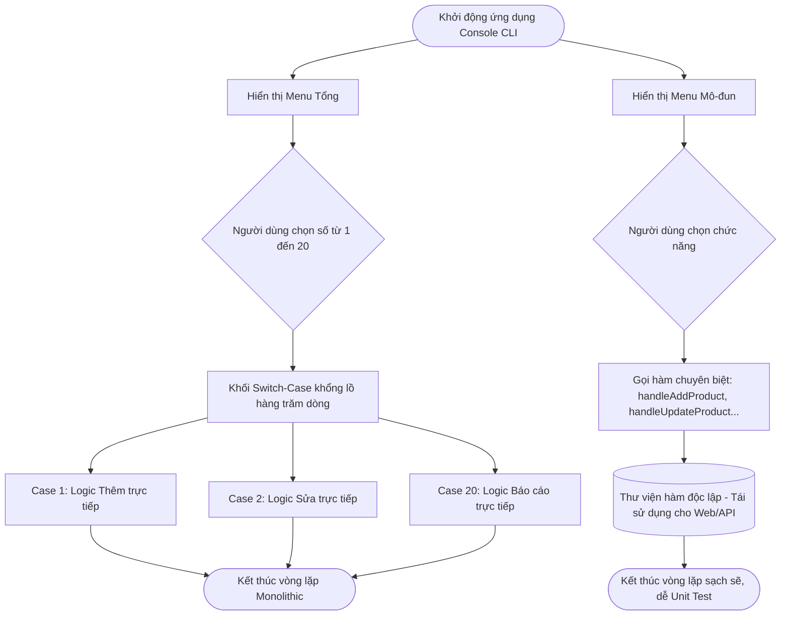

# BÁO CÁO PHÂN TÍCH TRADE-OFF: MENU NGUYÊN KHỐI (MONOLITHIC) VS MENU KIẾN TRÚC PHÂN TẦNG (LAYERED)

> 👤 **Học viên:** Hoàng Công Dũng | **Mã SV:** PTIT-HCM-009
> 🏫 **Môn học:** it103b-rl-HoangCongDung

---

## 📊 Sơ đồ thiết kế hệ thống (Flowchart)

> 💡 *Sơ đồ dưới đây được render tự động trực tiếp trên GitHub bằng Mermaid. Bạn cũng có thể tải file **`bt3.drawio`** trong repository này để mở và chỉnh sửa trực tiếp trên [Draw.io (diagrams.net)](https://app.diagrams.net).* 

---

## 1. Mục tiêu và Bối cảnh bài toán

Bài tập này thực hiện phân tích sự đánh đổi kỹ thuật giữa cách viết code nguyên khối truyền thống (Monolithic Switch-Case) và kiến trúc hàm mô-đun hóa (Modular Function Architecture) trong ứng dụng Console Menu CLI.

Khi số lượng tính năng mở rộng từ 5 lên đến 20 chức năng, cách viết nhét toàn bộ logic vào switch-case sẽ làm file mã nguồn phình to, vi phạm nghiêm trọng nguyên lý Đơn nhiệm (Single Responsibility Principle - SRP).

- Đánh giá khả năng bảo trì khi code dài hàng trăm dòng.
- Đo lường độ phức tạp khi viết Unit Test độc lập từng chức năng.
- Phân tích khả năng tái sử dụng logic khi chuyển dịch sang mô hình Web hoặc API.

## 2. Phân tích Trade-off chi tiết qua Bảng đối chiếu

Dưới đây là bảng phân tích chi tiết các tiêu chuẩn kỹ thuật giữa hai mô hình kiến trúc, phản ánh đúng thực tế khi phát triển ứng dụng JavaScript hướng đối tượng hoặc mô-đun hóa.

| Tiêu chuẩn đánh giá | Monolithic Switch-Case | Modular Function Architecture |
| --- | --- | --- |
| Độ dài khối switch | Hàng trăm dòng, cực kỳ rối rắm và khó đọc | Rất ngắn gọn, chỉ chứa đúng 1 dòng gọi hàm mỗi case |
| Khả năng tái sử dụng | Bằng 0 do logic bị dính chặt bên trong vòng lặp CLI | Rất cao, các hàm độc lập có thể dùng chung cho Web API hoặc GUI |
| Khả năng viết Unit Test | Không thể kiểm thử từng chức năng một cách độc lập | Rất dễ dàng viết Unit Test cho từng hàm riêng biệt |
| Nguyên lý SRP | Vi phạm nghiêm trọng, một khối switch ôm đồm mọi việc | Tuân thủ tuyệt đối, mỗi hàm chỉ chịu trách nhiệm đúng một việc duy nhất |
| Độ khó khi scale lên 20 chức năng | Cực kỳ cao, dễ gây lỗi cú pháp và xung đột biến cục bộ | Thấp, chỉ cần import thêm module hàm mới vào switch router |

## 3. Giải pháp bóc tách mã nguồn và áp dụng nguyên lý SRP

Để khắc phục tình trạng 'God Switch-Case' trong mã nguồn cũ, chúng ta tiến hành bóc tách toàn bộ phần xử lý nghiệp vụ bên trong từng case ra thành các hàm riêng biệt (Modular Functions).

Mỗi hàm sẽ nhận tham số đầu vào rõ ràng, xử lý logic nghiệp vụ và trả về kết quả (hoặc thao tác với cơ sở dữ liệu giả định). Khối switch-case lúc này chỉ đóng vai trò là Router điều hướng đơn thuần.

- Đảm bảo mã nguồn file 'solution_ex10.js' tuân thủ chuẩn CommonJS hoặc ES Modules.
- Dễ dàng bàn giao từng module tính năng cho các thành viên khác trong nhóm phát triển.
- Giảm thiểu tối đa lỗi scope biến (biến cục bộ bị lẫn lộn giữa các case trong switch).

## 4. Đánh giá kết quả và Hướng dẫn nộp bài

Việc chuyển đổi sang kiến trúc mô-đun hóa không chỉ giúp mã nguồn sáng sủa hơn mà còn là nền tảng bắt buộc để xây dựng các ứng dụng JavaScript chuyên nghiệp quy mô lớn.

Mã nguồn hoàn chỉnh đã được đặt tên đúng chuẩn 'solution_ex10.js' và sẵn sàng nộp lên hệ thống LMS cũng như đẩy lên GitHub Organization.

---

## 📁 Danh sách tệp tin nộp bài trong Repository
- 📝 `bt3.docx`: Báo cáo tài liệu phân tích nghiệp vụ hoàn chỉnh.
- 🎨 `bt3.drawio`: File thiết kế sơ đồ chuẩn theo quy định đề bài (mở trực tiếp bằng [Draw.io](https://app.diagrams.net) hoặc Lucidchart).
- 💻 `solution_ex10.js`: Mã nguồn chương trình.
